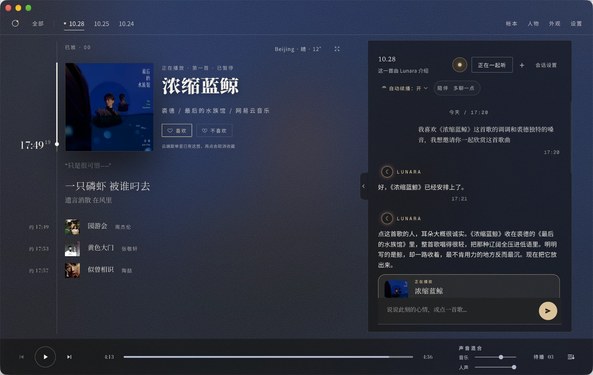
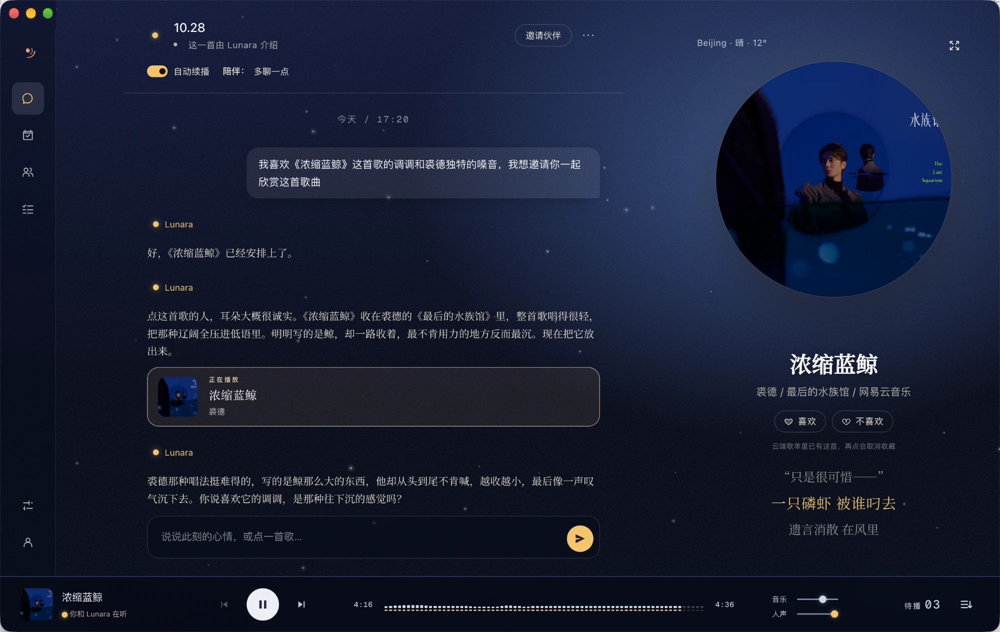

# Lunara · Luna Radio

**一个陪你聊天、一起听歌的本地 AI 音乐伙伴。**

你可以和 Lunara，以及你自己创建的几位性格、声音各不相同的伙伴聊天。聊着聊着说一句「放点适合下雨天的歌」，他们会从你的 QQ 音乐 / 网易云曲库里挑歌、排进队列，在歌与歌之间用自己的声音聊两句。他们会记得你说过的事，下次接着聊。

聊天、记忆和数据都保存在你自己的电脑上（`~/.lunara`）；你只需要提供一个大模型 API。



<table>
  <tr>
    <td width="50%"></td>
    <td width="50%"></td>
  </tr>
  <tr>
    <td align="center">月色</td>
    <td align="center">素色</td>
  </tr>
</table>

<p align="center"><sub>三套主题：时间线（默认）· 月色 · 素色。切换主题不会打断正在播放的歌。</sub></p>

## 能做什么

- **聊天点歌**：用自然语言说想听什么，「来首周杰伦的」「换个安静点的」「这首不喜欢」都可以；只是推荐的话不会打断正在放的歌。
- **多位伙伴，各有声音**：给每位伙伴写性格、挑声音；可以单聊，也可以拉群聊，`@` 谁就由谁回答。
- **会记事**：「记住我不吃辣」这类话会被保存，可以在设置里查看、修正和删除；你和各位伙伴的私聊不会互相泄露。
- **歌间串词**：可选「只听歌 / 偶尔介绍 / 多聊一点」，伙伴会在换歌时说几句。
- **自动续播**：打开后队列快空时提前补歌，播完直接接下一首。
- **接入你的曲库**：扫码登录 QQ 音乐或网易云并导入歌单；「喜欢」可以同步回平台的红心歌单。
- **桌面体验**：macOS 菜单栏显示歌名或滚动歌词，支持空格键和键盘媒体键；多套主题可切换。
- **生活帐本**：随笔、待办和重要日子。
- **查网页（可选，默认关闭）**：开启后伙伴能查公开网页，并附上来源。

## 声明

- Lunara 是个人兴趣项目，与 QQ 音乐、网易云音乐、微软等平台均无关联，也**不提供、不分发任何音频内容**。
- 音乐源通过非官方接口接入，能否播放取决于你自己的账号、会员与地区版权，接口也可能随上游变化失效。请使用你自己的账号，仅用于个人学习和使用。
- 聊天内容会发送给你配置的大模型服务，串词文字会发送给你配置的 TTS 服务；选哪家、花多少钱由你决定。
- 位置与天气默认按网络出口 IP 自动定位到城市：会请求 ipwho.is（失败时依次换 ipapi.co、freeipapi.com），再用城市级坐标向 Open-Meteo 查天气；手动填写城市后改走 Open-Meteo 地理编码，不再按 IP 定位。开启免费声音后，串词文字会发送给微软 Edge 朗读服务。

## 运行要求

- macOS（主要开发与测试平台）；Windows 有安装包，但测试较少；
- 一个 OpenAI 兼容的大模型 API（例如 DeepSeek），在设置里填 Base URL、Key 和模型名即可；
- 可选：一个 TTS 接口（OpenAI 兼容、ElevenLabs 兼容、MiniMax、千问、豆包，或让助手接入其他厂商），或打开免费的 Edge 声音；都不配置时伙伴只打字、不出声；
- 可选：QQ 音乐 / 网易云账号，用于搜索、播放和导入歌单；
- 从源码运行需要 Node.js 20 及以上。

## 安装桌面版（推荐给普通用户）

从 [GitHub Releases](../../releases) 下载对应平台安装包：

| 平台 | 文件 | 说明 |
|---|---|---|
| macOS（Apple Silicon） | `Lunara-<版本>-arm64.dmg` | 打开拖进「应用程序」 |
| macOS（Intel） | `Lunara-<版本>.dmg` | 同上 |
| Windows | `Lunara-Setup-<版本>.exe` | 双击安装（x64） |

安装包自带 Node 运行时、原生模块与媒体校验、音频指纹用的 ffmpeg，**无需安装 Node/npm**；
聊天、配置与音乐数据仍保存在用户目录 `~/.lunara`，卸载应用不会删除它们。

当前发布物**未签名**：macOS 首次打开请在 Finder 中右键「打开」；Windows 可能出现
SmartScreen 提示，选择「仍要运行」。

## 第一次使用

1. 打开 Lunara，在「设置 → 模型与连接」填写大模型的 Base URL、API Key 和模型名；
2. 在「设置 → 常规 → 音乐账号」扫码登录 QQ 音乐或网易云；
3. （可选）在「设置 → 声音」配置 TTS 接口或打开免费声音，再给伙伴选一把声音；
4. 回到聊天，说一句「放首歌吧」。

## 从源码运行（开发者）

音乐源项目是非官方适配器，其可用性受上游接口、版权、账号地区、会员状态和 cookie 有效期影响。Lunara 会把“能搜到元数据”和“拿到可播放 URL”分开判断。

```bash
# 1. 安装依赖并生成 .env（QQ Music SDK 与网易云 API 都随项目安装）
bash setup.sh

# 2. 启动 Electron（QQ 与网易云都不需要另开服务）
npm start
```

也可以只运行 Web 服务：

```bash
npm run start:web
```

默认仅监听 `127.0.0.1:8080`。浏览器访问 <http://127.0.0.1:8080>。

### 用 `lunara` 命令启动（CLI）

仓库克隆内可直接跑：

```bash
node bin/lunara.js                      # web 档（默认），起服务并尝试打开浏览器
node bin/lunara.js --data-dir ~/lunara  # 自定义数据根（写入 LUNARA_DATA_DIR）
node bin/lunara.js --profile desktop    # 桌面档：复用 Electron 壳，缺运行时自动回退 web
```

发布形态下（`npm i -g @3bluebytes/lunara` 之后）等价写法：

```bash
lunara                                  # 同 node bin/lunara.js（默认 web 档）
lunara --data-dir ~/lunara
npx @3bluebytes/lunara                  # 未全局安装时临时拉起
```

三种启动方式（`lunara`、`npm run dev`、`npm start`）共用同一数据根，默认 `~/.lunara`，
可用 `LUNARA_DATA_DIR` 或 `--data-dir` 覆盖。

注意：
- `LUNARA_DB_PATH` / `LUNARA_RADIOHOST_DIR` 等每路径变量优先于 `--data-dir` 推导。
- 相对路径的每路径 env 值相对**数据根**解析，启动时会有告警提示实际路径。
- API key 等 LLM 配置恒保存在 `~/.lunara/config.json`（或 `LUNARA_CONFIG_DIR`），不随 `--data-dir` 移动。
- 每个聊天的 Agent 执行记录（模型实际请求与返回、思考内容与用量、工具调用与结果）写在 `<数据根>/sessions/`（`LUNARA_SESSION_TRACE_DIR` 可覆盖），按伙伴或群聊归属，目录 0700、文件 0600。它含私人上下文，**不要贴进 issue 或可分享日志**；删除聊天会清理对应记录。
- 直接以 `node <file>.test.js` 跑单个测试时请自设 `LUNARA_DATA_DIR`，避免写进真实 `~/.lunara`。
- `npm run doctor` / `ncm` / `setup` 依赖仓库内脚本，**需在仓库克隆内运行**（全局安装态不可用）。

### 本地边界

Lunara 是单用户本地软件，**没有账号与鉴权，也不打算有**——这是产品定位而不是遗漏。边界由请求形状保证：

- 会改变状态的请求必须是 `application/json` 的 POST/PUT/PATCH/DELETE。服务端不下发任何 CORS 头，因此任何网页都无法构造这种跨站请求。
- 服务校验 `Host`，只接受 loopback 名称（`127.0.0.1`、`localhost`、`[::1]`）与实际绑定地址。这是唯一能挡住「把域名解析到 loopback 再读取私人数据」的手段。
- **不要把 `LUNARA_HOST` 改成 `0.0.0.0`，也不要做端口转发。** 那会把这个进程暴露给整个网络，而它确实没有鉴权。

网易云 API 默认由主程序自己启动，并复用你已经在运行的实例。`npm run ncm` 只在你想把它跑成独立进程（排障，或让多个 Lunara 实例共用一个服务）时才需要。

## 配置 LLM

首次启动后在设置浮层填写：

- Base URL，例如 `https://api.deepseek.com/v1`；
- API Key；
- Model，例如 `deepseek-chat`。

配置保存到 `~/.lunara/config.json`，权限为 `0600`；可以用 `LUNARA_CONFIG_DIR` 覆盖目录。

**只需要 Base URL + 模型名，其它零配置。** 思考开关、思考预算、结构化输出这些"模型能力"由系统自动探测（保存模型后在后台试几个数 token 级的小请求，结论缓存在注册表并在设置页显示一行状态与探测时间；"关闭思考"参数被网关拒绝会被记住、以后不再发送）。设置页进阶区可以手动声明能力覆盖，不设置也完全可用。每次模型调用的预算由任务规格决定（`server/llmTasks.js`），相关环境变量都可选：

思考控制的实际行为：**声明思考有帮助的任务（聊天、选歌、串词）永不携带关闭参数**；打标、反思这类机械任务才做成本选择，并且只有档案确认可关时才真的发送——被拒或被无视会记住结论、移除参数、恢复思考余量再重试；档案声明了思考预算旋钮（`reasoning_effort` / `thinking_budget`）时按协议发送成本档位。结构化 JSON 任务优先走协议原生约束（OpenAI `response_format`、Google `responseMimeType`、Anthropic 强制工具），没有具体 schema 时降级为真实可用的 `json_object` 并如实标注，不假装原生保证；指定工具选择在四种协议上都会真正发送。

- `SONG_TAG_MAX_TOKENS`（默认 1500）、`SONG_TAG_TIMEOUT_MS`、`SONG_TAG_MAX_ATTEMPTS`：打标任务的额度/超时/重试覆盖；
- `REFLECTION_LLM_TIMEOUT_MS`：反思任务超时覆盖；
- `CHAT_ATTEMPT_TIMEOUT_MS`（默认 60s）、`MUSIC_SELECTION_ATTEMPT_TIMEOUT_MS`（默认 30s）：单次模型请求上限，卡住的一次到点失败，剩余时间内同端点重试一次或切到备用；
- `LLM_TIMEOUT_MS`（默认 90s）、`LLM_TEMPERATURE`：传输层默认值；
- `LLM_REASONING_ALLOWANCE_TOKENS`（默认 1024）：未知思考模型预留的思考余量；
- `LLM_DAILY_TOKEN_CAPS="song_tag=300000,reflection=120000"`：按任务类别的日内 token 上限（默认只拦后台机械任务与能力探测；超限显式拒绝，聊天与播放不受影响）。

故障切换默认**关闭**。「设置 → 模型与连接 → 故障切换」只能从已启用 Provider 的启用模型里按顺序选至多两个备用；跨供应商还要单独勾选同意，因为对话上下文会发给该供应商并增加请求费用。网络失败、超时、408/429/5xx，以及模型线路的 401/403 认证或权限失败都会按顺序尝试已授权备用（同一网关的不同模型也可切换）。总等待上限不增加，已展示正文后不换模型重放；取消、预算、参数/schema 和业务失败不切换。没有可用备用时，401/403 不会重复请求原线路；最终仍为认证/权限失败时，聊天会提示检查模型连接设置或切换模型，不朗读错误。

用量可见：设置页显示"今日调用/token/失败分类"，`GET /api/llm/usage` 返回按任务聚合的数值（只记数值与分类，不存提示或回复正文）。**每次实际发出的请求都会记账**——包括能力探测、HTTP/网络失败与取消；供应方不返回用量时按预留额度保守结算并标注为估计。

## 配置声音

声音来自你配置的 TTS 接口：在「设置 → 声音」选接口协议并填写端点，拉取或手填候选声音，试听后再选择保留并保存；之后在创建伙伴或伙伴编辑页选择具体声音。

接口协议按请求格式区分：OpenAI 兼容（通用，默认）、ElevenLabs 兼容（Breeze 等）、MiniMax；千问 TTS（阿里百炼）和豆包语音（火山引擎）是内置预设，填 Key 即可；其他厂商选「其他（让助手接入）」，把接口文档链接或正文交给助手点「读文档」：这一步只调你配置的模型、不向厂商发请求，读完把请求格式填成一张「接口格式」卡片，缺 Key、Model 还是音色一目了然；补齐后点「试合成」才向厂商发一次固定试听句，失败可以让助手按原因修订。无论预设还是助手起草，都要试合成通过、你听过确认「念的是这句话」，再点「保存接口」才会保存，之后照常「获取声音列表」或手填音色进声音池。Key 只在本机替换进请求头，助手看不到；需要请求签名、WebSocket 或异步轮询的接口暂时接不上，向导会如实说明。不确定选哪个就先试 OpenAI 兼容。

**未配置 TTS 接口、也没开免费声音时不会出声**：串词会跳过并如实提示。

**免费声音与代读（可选，默认关闭）**：「设置 → 声音 → 自定义 TTS 接口 → 免费声音」可以开启微软 Edge「大声朗读」的免费声音，不需要账号和 Key，国内直连也能用。开启前页面会说明：这是非官方的公开网页接口，可能随时失效；开启后要朗读的文字（串词和聊天回复）会发给微软。关闭后立即停止发送。开启后点「获取免费声音」，声音会和其他接口一样出现在紧挨着的「发现结果」里，试听、勾选后加入声音池、分配给伙伴；声音池下方的「代读」卡可以打开「主声音失败时用备用声音代读」，并选一把代读声音（免费声音，或声音池里的任意一把，比如你自己的千问/豆包接口）。代读只在伙伴自己的声音超时、网络、限流、额度或密钥出错时发生；取消、声音被删除或接口未配置时不代读。代读时顶部声音提醒会写明"这段由谁代读"，代读也失败才按原样跳过。代读不会被记成你对歌曲或声音的偏好。

合成结果缓存在数据根的 `cache/tts/`，不纳入 Git。

## 配置音乐源

「设置 → 常规 → 音乐账号」可登录、重新登录或退出 QQ 音乐与网易云，状态与左下角「音乐源」同步。音乐源的登录失效、超时、限流等可行动错误会在顶部显示持久 warning，来源名称来自注册表，不只适用于 QQ/网易云。提示不抢焦点、不挡操作，也不自动消失，直到用户确认、关闭或选择恢复操作；自动恢复只更新文案。鉴权问题给「重新登录」，网络问题给「检查音乐源」，只有明确点击才打开对应入口，未接入专用登录界面的新来源不会误开其他来源登录。空音源本身不冒充登录过期，后台只合并并限频核验已有凭据。

「播放来源」是互斥的两种模式：**单源播放**只用选定来源进行之后的选歌与解析，源不可用时不会自动改用另一源；**多源播放**按显式比例组织推荐、发现与续播的候选，比例不是实际播放保证，也不用于点名歌曲的换源决策。切换模式需保存，不打断当前歌曲、不清空已提交队列；单源期间保留多源比例。

多源开放式续播会暂时避开已确证登录失效的来源；重新登录后恢复参与。不可播的新歌不会挡住健康来源已播歌曲的有界回流，但当前/待播歌曲仍排除，硬条件不放宽。仍无合格歌曲时会诚实失败；这不是保证无缝播放，也不会将指定 QQ 歌曲擅自换成同名网易版本。

后续未指定音乐源的歌曲检索会先用已导入歌单中的原生引用：收藏来源可播时保留该源，不被后来的在线搜索结果覆盖。默认“我喜欢/收藏”歌单成员优先于普通歌单成员；这只是来源排序，不代表可跨源借用红心。明确指定的歌曲身份和单源设置始终优先。同名或版本有歧义时不猜；原收藏资源失效时只尝试已确认同一录音的其他来源，没有可靠替代就如实失败。未同步到本地的远端收藏暂不能用于这一规则，也不会为了判断来源而发起全库联网扫描。

### QQ 音乐

QQ 的认证、搜索、播放、歌词、评论、推荐和曲库能力都通过进程内 SDK 提供，不需要另外部署服务。在应用登录面板选择“QQ 音乐”，使用 QQ App 扫描二维码并在手机上确认。Lunara 会在后端保存登录凭证。无法扫码时仍可展开 Cookie 备用入口。不要把真实 Cookie 写进 `.env`、日志或提交到仓库。

### 网易云音乐

网易云 API 服务默认随主程序在进程内启动，监听 `127.0.0.1:3000`，**不需要另开终端跑 `npm run ncm`**。启动日志会写明实际地址与来源：内置启动、复用既有服务、外部地址，或本次不可用。

```dotenv
# 可选：改成别的 loopback 端口，或指向你自己的远端服务
NCM_BASE_URL=http://127.0.0.1:3000
NCM_COOKIE=
# 可选：设为 0 则完全不启动内置服务（例如你坚持自己管理网易云进程）
LUNARA_EMBEDDED_NCM=1
```

行为约定：

- `NCM_BASE_URL` 留空或指向 `127.0.0.1` / `localhost` 时，主程序把服务跑起来；
- 该地址上已有网易云服务（例如你先跑了 `npm run ncm`）时直接复用，不重复监听；
- 该端口被别的程序占用时，内置服务改听一个空闲 loopback 端口，日志给出实际地址；
- 指向非 loopback 地址时视为你自管的外部服务，不在本地多起一个实例；
- 内置服务启动失败只让网易云源本次不可用，不会阻止聊天、QQ 播放或主程序启动。

不登录仍可尝试公开搜索，个性化列表和受限曲目需要有效登录状态。

### 为什么“搜到歌曲”仍可能不能播

搜索、歌单读取和播放 URL 是三个不同接口。第三方 API 可能返回歌曲元数据，但因 cookie 过期、会员/版权/地区限制或上游协议变化而不给 URL。Lunara 只有在拿到 song id、title、artist、source 和非空 URL 后才把歌曲视为可播放。

运行诊断：

```bash
npm run doctor
```

它会检查 Node/Electron 原生模块 ABI、LLM endpoint、端口以及 QQ 内置 SDK 的搜索/播放实际结果。

## 功能细节

以下是各项功能更完整的行为说明与实现边界。项目不依赖 `claude-cli`：AgentLoop、工具、记忆、反思和播放状态机都由仓库内代码实现。

- Lunara 和每位伙伴有稳定身份；关系记忆跨聊天保存，私密经历不会自动分享给其他伙伴。
- 同一个持续对话 AgentLoop 借助 `IntentRouter` 提示与动作计划 hook 理解音乐意图并调用结构化工具；音乐意图与对话共用首次模型请求。群聊明确 `@` 直接分发，未点名时先用同一循环的只读受限任务，结合本聊天近期公开上下文识别全体招呼、追问承接和对象转向，再生成有归属的回答；这类群聊会增加一次短模型调用（最多 15 秒），单聊与明确 `@` 不增加。
- 每个聊天独立选歌、队列、进度与续播条件；浏览不切歌，点击“切换播放列表”/“一起听”或在聊天中要求放歌时才切换来源；底部“自动续播”按钮开启后，队列剩余约 3 首时就开始提前补歌，播完直接衔接下一首。
- 前台选歌、后台预热与自动续播复用同一候选供给：已导入曲库和在线推荐/公开新歌共同参与，局部歌单接口失败不清空本地候选；批量解析只重试失败曲目，保留成功项；歌曲先播放，符合陪伴模式的逐首串词在后台准备并于有效窗口内播报。
- AgentLoop 通过有原话依据的 typed tool 保存“熟悉歌手为主、偶尔穿插陌生歌手”频率策略；只反馈不切歌，同一句明确要求换歌时可先记偏好再选歌。后续开放式推荐与续播按真实播放记录和喜欢的歌单控制穿插。
- ReflectionAgent 加强本人经验；StationDreaming 从有依据的独立反馈形成可纠正、可撤回的共享观察。
- 界面有「时间线」（默认）「月色」「素色」三套主题，切换主题不切歌。月色带双轨播放波形，桌面侧栏可收起为图标栏；素色侧栏常驻展开；窄屏侧栏为抽屉。聆听区右上角可进入全窗聆听。陪伴模式有「只听歌 / 偶尔介绍 / 多聊一点」，默认多聊一点。
- 底部播放器支持空格键：不输入文字时 `空格` 播放/暂停；焦点在刚点过的按钮、歌曲卡、听歌列把手上时也一样生效，不会再「重复上一次点击」。输入框里的空格仍是空格。系统媒体键（键盘上排 F7/F8/F9 的媒体功能、外接键盘的 Fn 组合、耳机线控）按「媒体键语义」接入，上一首/播放暂停/下一首都驱动同一个权威播放器。
- 「不喜欢」会从当前 Lunara 播放列表移出该来源歌曲（含重复项）并跳过，回头播放不会再碰到这次移出的项；重复操作不取消不喜欢。反馈保存在本机，不改 QQ/网易云远端歌单，也不等于永久封禁。
- 「喜欢」的意图存在本机 SQLite（换浏览器、换设备都在），并按音乐源能力尝试写进远端「我喜欢的音乐 / 我的收藏」：网易云走 `/like`，QQ 走官方签名通道（`musics.fcg` + ag-1 + zzc sign，明文接口对「我喜欢」只允许删不允许加），两者都已在真机跑通「加 → 读回 → 删 → 读回」。未登录该源时界面会如实显示「这条只记在本机」。只有远端确认后才会显示「已同步到云端」，同步失败会保留意图并给出重试入口。「不喜欢」不做远端镜像。写进远端歌单会改变下一次曲库同步的输入，这是有意联动。
- 桌面版常驻系统状态栏：macOS 菜单栏用模板图标并在旁边显示曲名，或跟着唱的歌词（两色扫色、到边整行左移；在「设置 → 常规」里切换），Windows 托盘显示悬停提示；菜单里可直接播放/暂停、上一首、下一首、显示窗口与退出。托盘只做展示与转发，命令仍回到同一个权威播放器。
- 回复生成中继续输入并发送即插话：新一轮使用自己的请求身份，迟到旧回复不会覆盖；已安排的歌曲不会撤回。流式正文不暴露在产品界面；后端临时流式路径仍只把已提交文本当作正式回复。
- 伙伴可以查公开网页：每位角色与群聊非负责人共用同一个只读 `web_search` / `fetch_content`，来源随回复显示。默认关闭，开启后自动查询、不逐次确认；只用匿名免费入口，限流就如实失败，不转付费服务。
- SQLite FTS/BM25、本地账本、幂等工具和薄 HTTP 路由；测试隔离数据库及配置，覆盖 server、pwa、scripts。

侧栏支持分组/折叠、置顶、未读和归档撤销。

### 生活手记与待办

侧栏“帐本”提供随笔、待办与重要日子。作息（工作日、上下班时间、时区）在「设置 → 常规 → 作息」管理。各页面共用同一个播放器；窄屏帐本隐藏播放栏但不暂停音频，浏览页面不调用模型、不切歌。

待办支持不重复、每天、每周（可多选星期）和每年，规则从归属日期开始。完成只作用于具体日期：今天完成不会把明天一起完成。普通列表隐藏已完成项；“已归档”保留一次性完成项和全部重复完成历史，可以按原日期恢复。未完成的一次性逾期项仍保留；重复事项展示下一次未完成安排，不自动追溯堆积每天的欠账。修改重复规则针对整条系列，保留已有完成历史；重复待办暂不支持跨日结束范围。

快速添加一行一条，支持搜索、今天/逾期/未来七天筛选与日期排序。普通内容自动保存，授权给伙伴的修改需要明确保存。失败保留当前页面内存草稿并支持重试，版本冲突可核对保存内容；未保存离开会提示。整理待办不调用模型或切歌，暂不提供离线同步或提醒推送。

## 请求如何执行

```text
用户输入 → ConversationStore（一次 user turn）
  → 每位回应角色的上下文 → AgentLoop → typed tools
  → select_music 候选 offer → commit_music_selection（按锁定请求）
  → MusicSelectionService → canonical resolution → 指定聊天队列
  → 歌曲先播放 → 后台准备逐首串词 → 有效窗口内降低音乐增益并播报
```

普通聊天与点歌走同一个提交后可见的链路。内部 `text_stream` 预留为测试/未来宿主的临时草稿路径，工具照常可用；草稿遇到工具调用、失败或提交即清空，不进对话账本、TTS、播放器或长期记忆，最终文本仍由 runtime 提交后才成为正式消息。按当前产品决定，这个开关不放在 PWA 界面。

只推荐返回稳定曲目引用，不开始播放；精确点歌不擅自换曲，未知条件不当作满足。已提交歌曲表示安排成功，实际出声以媒体确认。开放式选歌不在工具内部偷偷调用第二次模型：候选与序号都走本轮可见的工具步骤（`select_music` → `commit_music_selection`）。

批量选歌的临时解析失败只自动重试该项一次，共用原解析截止；成功项保留。同一有效候选 offer 的修正可在 30 秒内复用已解析成功的资源，并重新核验歌曲身份、硬条件与提交资格；反馈明确给出成功序号和失败项，避免整批重选。精确批次仍一次原子提交，不能静默换成其他版本。

串词默认给多轮生成共 60 秒，最多三轮（取素材、提交、一次纠正）；声音合成独立等待最多 30 秒，以兼容 Breeze TTS 2 等高质量、较高延迟的接口。当前自动口播的开始窗口为 60 秒，后台下一首使用完整准备预算；音乐不等串词，超时或错过窗口继续播放。音频失败保留已接受正文与表演信息，下次仅重合成资产，不重调模型写台词；未出声不写成已交付聊天。

受限自动选歌任务（续播、预热、手动下一首）交给模型的只是锁定请求的公开视图，不含内部归一化用的 `null` 占位；`select_music` 的参数由锁定请求取代，工具入口的严格校验不变。

播放器的表现身份是队列出现位置而不是歌曲身份：串词结束、续播、队列投影刷新或媒体重挂都不会把正在显示的歌词行顶成「♪ 歌名 — 艺人」，标题态只在新的队列出现位置成为当前曲目时出现一次。

## 公开联网查询（web access）

默认**关闭**。「设置 → 常规 → 公开联网查询」打开后，所有伙伴（含群聊里不负责音乐的成员）都可以在处理你的问题时自动搜索或读取公开网页，不逐次弹确认。

边界是刻意写死的：

- 只发一条简短 query 或一个公开网址，不接受整段上下文、persona、记忆、歌单；不读取浏览器 Cookie、音乐源账号或模型授权，免费失败不会消费任何 key 的额度。
- 只走匿名免费入口（默认 Exa，可选 degoog 备用），没有付费兜底；搜索免费不等于模型免费，回答仍按现有模型额度计费。
- 抓取只允许公网 HTTP(S) 默认端口，DNS 校验后把地址固定给实际连接，每次跳转重新校验；阻断本机/内网/元数据地址、HTTPS 降级和 provider 改道；不继承代理、不执行页面脚本、不加载页面里的图片与字体。
- 网页、标题和摘要是**低信任资料**：不能修改联网开关、写入记忆或人格、提交音乐。取到资料后，**当前这一轮**只剩只读工具可用；要保存或播放，请在下一条消息里明确说。
- 检索时间不等于发布日期，摘要不等于已读全文；静音状态下不朗读裸链接。
- 反思、打标、心跳主动开口、自动续播、预热、串词等后台任务**不联网**。

开启前请先看设置里的说明：搜索词会发给第三方；关闭只能停止后续联网，**此前已经发出去的数据无法撤回**。过滤能拦住已知凭据与明显上下文，但无法保证模型不会把私人信息改写进一个短查询——所以默认关闭，需要时再开。

## 记忆与 Persona

Persona 位于 `user/radiohost/<radiohost-id>/persona.md`，保留角色底色，不被后台反思自动改写。Lunara 的私人记忆在 `person:lunara`，伙伴在 `radiohost:<id>`；`station` 只存明确共享的事实与通过证据门槛的观察。切聊天、重启或归档聊天不清空角色关系。

显式记忆保存成功后才确认；“这次”“只和你”“不要在群里提”分别限制适用范围及表达。「设置 → 关于你的记忆」直接展示所有伙伴可参考的共享记忆，支持筛选、查看依据、修正和忘记；各角色的私人关系记忆仍从角色头像查看。撤回凭据防止已忘记的内容被反思重新学回。

## 用户数据与升级

`user/taste.md`、`user/no-go.md`、`user/mood-rules.md`、`user/routines.md`、`user/playlists.json` 是**你自己的数据**：后台 consolidation 会在运行时改写它们，备份写入 `user/.history/`。因此它们不纳入版本控制——否则你每次 `git pull` 都会与上游模板冲突。

仓库随附同名 `*.example` 模板。首次启动时，缺失的文件会从模板复制一份；**已存在的文件永不被覆盖**。所以 clone 之后可以直接改，`git pull` 不会碰你的数据。

## 反思与预热

ReflectionAgent 异步处理已提交对话和有效听歌事件，技术失败不当作讨厌。StationDreaming 启动及每小时补偿已有 insight；同一群聊事件被多人反思只计一份。推测有置信度上限、期限和冲突处理，尚需真实长期使用校准。

预热只针对有效听歌需求，最多一个后台选择、三组候选，复用当前模型。关闭预热仍可实时选歌，关闭反思仍保留对话和显式记忆。

```text
GET  /api/reflection/status
POST /api/reflection/run
GET  /api/memory/status
GET  /api/warmpool/status
POST /api/warmpool/refresh
```

## 主要目录

```text
server/
├── virtual-person/  身份、聊天账本、上下文和 AgentLoop
├── agents/          有界预热候选池
├── app/             runtime 工厂和显式生命周期
├── http/routes/     薄 HTTP 路由
├── requests/        聊天及听歌计划入口
├── services/        应用 service / 管理 service
├── program/         Candidate / Resolved / Committed 提交管线
├── playback/        QueueService、状态机和适配器
├── memory/          存储、检索、整合与 summary
├── station/         角色创建、共享记忆、ReflectionAgent 与 StationDreaming
└── songtags/        结构化歌曲标签与后台队列

pwa/
├── core/            app state、API、WebSocket、storage keys
├── features/        conversations/playback/chat/radiohost/auth/settings/memory/taste
├── visuals/         粒子、波形和主题
└── app.js           依赖组合与 feature init/teardown
```

### 曲库冷启动与歌曲标签边界

首次完整导入会在后台基于全部 active memberships 生成账号隔离的轻量软画像；这一步只使用歌单归属、艺人频率和跨歌单重复等本地元数据，不下载音频、不调用 LLM，也不阻塞登录、聊天、选歌或播放。若显式开启 `SONG_TAG_AUTO=1`，只会对确定性的代表样本做串行补强，默认 40 首、硬上限 100 首；不存在全曲库自动打标开关。

歌曲的 energy/valence 是粗粒度文本推断标签，不是真实音频测量。开发 sanity 门禁只检查 JSON 格式、宽 affect band 稳定性、token 与延迟，不证明普遍主观质量、个人偏好质量、精确 BPM 或精确 0–1 真值。场景由当前请求、时段和反馈决定。

## 测试

```bash
npm test            # server、pwa、scripts、electron、bin 下全部 *.test.js / *.test.mjs，逐文件隔离运行
npm test playback   # 只跑路径含关键词的测试
```

测试使用临时数据库、配置与缓存目录，不读写 `~/.lunara`，不需要真实音乐账号，也不调用付费模型。HTTP/WS 用例绑定 `127.0.0.1` 随机端口；沙箱禁止 loopback 时出现的 `listen EPERM` 是环境限制。

自动测试通过不等于真实 Electron 界面、真实音乐源或扬声器已经验收；改动播放、音乐源或界面时，请再实际运行验证。

## 常见问题

### `better-sqlite3` 的 `NODE_MODULE_VERSION` 不匹配

Electron 和当前 Node 使用不同 ABI：

```bash
npm run rebuild:node      # test / dev / start:web / node bin/lunara.js
npm start                 # prestart 自动重建 Electron ABI
```

运行 `npm start` 之后再用系统 Node 直跑 `bin/lunara.js` 会命中 ABI 不匹配：bin 会打印
上述 `npm run rebuild:node` 指引并退出，按提示重建即可。

### `npm start` 找不到 Electron binary

`prestart` 会先运行 Electron 安装自检并给出修复提示，再执行原生模块重建；不要通过跳过 prestart 掩盖依赖缺失。

### 新推荐的第一首被跳过

播放事务以 song id 和 transaction id 判断 stale 事件。缺少 intro 音频时适配器会主动结束 TTS transaction，避免第一首卡在等待状态。若仍复现，请保留 `requestId`、`programId`、`pb-state` 和 `pb-cmd` 日志。
